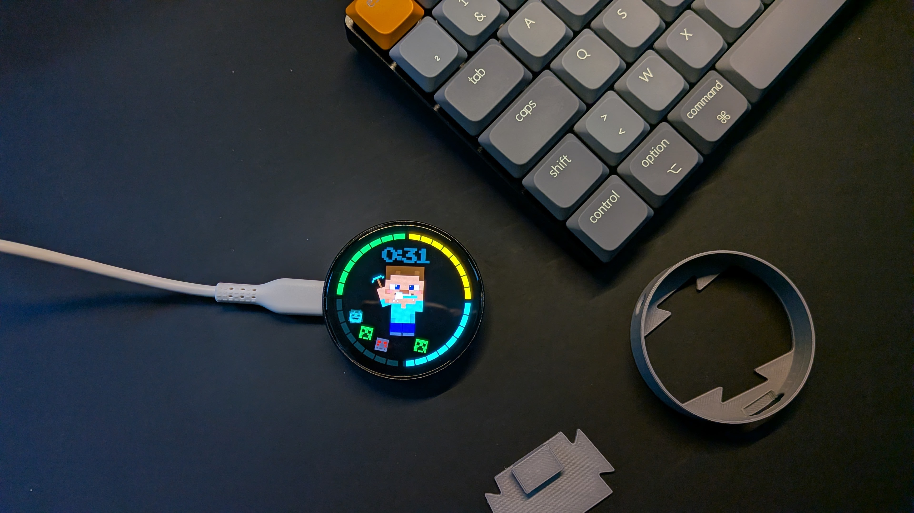

+++
date = '2026-11-22T17:03:48+01:00'
draft = true
title = 'Clean Teeth'
description = 'test'
tags = ['3D print', 'ESP-32', 'Toothpaste']
featured_image = 'pics/screenTest.jpg'
+++

My kids are currently into some deep passions. My youngest is Minecrafting every time he can, my eldest is reading "Wings Of Fire" a 16 tomes fantasy story with dragons. And in common, they both have a shared passion, grumble and moan when time has come to brush their teeth. so why combine all of this and see what could come out of these !

# The plan

I had seen some [Waveshare](https://www.waveshare.com/esp32-s3-touch-amoled-1.75.htm?sku=31262) screens on many other projects and I always wanted to try one and see what I could do with theme.

The first step was to create the software with Claude, with the hardware limitations backed in. I asked to create a 2 minutes timer, with switchable themes of a character brushing his teeth, enhanced with small animations, peek-a-boo, slides and per theme animations. The Minecraft theme was perfect on the first try. It suggested the XP animation, small green spheres attracted by Steve. I then asked to have a mine animation, it felt mandatory. For the Wings Of Fire, I used the comics as inspiration and I had to tweak the style multiple times, as it is more complicated than the Minecraft style. Claude suggested the rainbow animation as Glory do that apparently, I asked to have her flying, while keeping brushing her teeth !



# First screen test
Once the screens received, I discovered two things. First they looks really great, very bright with beautifull colors. Second thing I discoverd is that I read the product description to fast, as the battery is not included inside the case.

So I ordered two batteries and started designing the stand for this.

# CAD

This time I tried Onshape, and will keep using it instead of Fusion 360. It's quite easy to learn after Fusion, works really well and is web based, which is the biggest point for me as I use a variety of MacOS / Linux comuters.






I kept it straight forward, as I was learning the tool while doing it, I avoided complex compound shapes. I still like the design, the only problem I see is that the base is to big, but I chose a 3.7V 2000mAh battery to run for months, and this take some space

# Printing and assembly






The battery came with a JST connector, but the screen takes an MX1.25 port, so I had to solder it to the battery. I don't remember where I read this, but as it is a greate advice I will write it here to, when cutting the cable of a battery, never cut them both at the same time, as the cutting pliers could make contact and damage the battery.






And like that, my two Cleen Teeth Timer were ready !








As I write those lines, I haven't yet shown this to my kids, but as I trust my instinct, and it is strong and clear, I know that the two times a day complaints will be behind, for at least 3 days.
